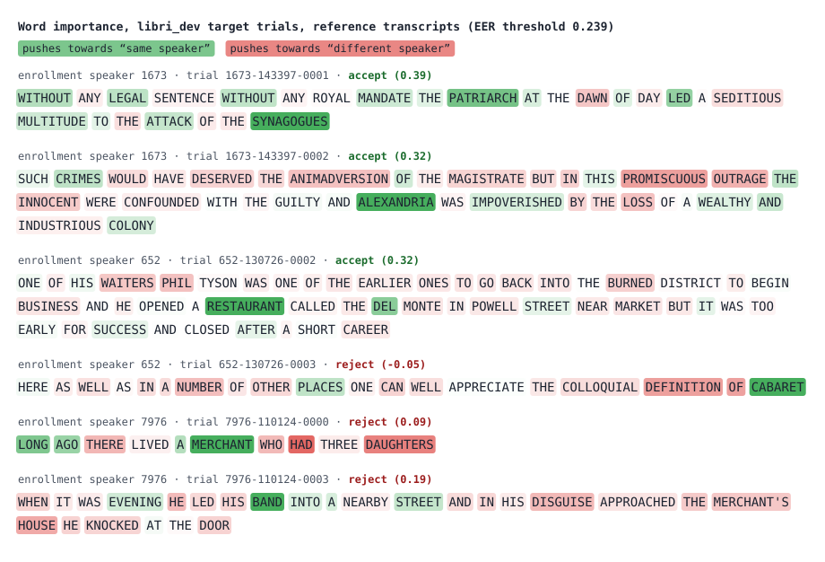

# Text attacker

An additional attacker for the privacy evaluation: speaker verification from transcripts only. It answers the
question: *how well can trial utterances be linked to enrollment speakers from the linguistic content alone, without
listening to the voice?*

The privacy metric is the equal error rate (EER), computed on the official enrollment and trial data with the same
trial lists and the same EER routine as the ASV evaluation. The text attacker complements the semi-informed ASV
attacker of the challenge: the ASV attacker listens to the anonymized speech, the text attacker reads what is said.
The attack model differs from the semi-informed one: the enrollment data are original, only the trial data are
anonymized, and the attacker is not trained on anonymized data.

## How it works

1. A frozen multilingual text encoder ([BAAI/bge-m3](https://huggingface.co/BAAI/bge-m3)) encodes a transcript;
   the last-layer token states are mean-pooled into one 1024-dimensional vector.
2. A small trained *head* (`Linear(1024, 512)`, ReLU, `Linear(512, 256)`, L2 normalization) maps this vector to a
   speaker embedding.
3. The embedding of an enrollment speaker is the mean of the embeddings of the speaker's enrollment utterances.
4. A trial score is the cosine similarity between the enrollment speaker embedding and the trial embedding; the
   metric is the EER.

Only the heads are trained, on original (not anonymized) data. There is one head per corpus and language (dataset
prefix):

| Head | Used for | Training data | Training text | Speakers | Objective |
|---|---|---|---|---|---|
| `libri` | Track 1, `libri_*` | LibriSpeech train-clean-360 | reference transcripts | 921 | softmax |
| `en` | Track 2, `en_*` | Track 2 `train_english` (MLS) | Whisper large-v3 transcripts | 3930 | AAM-softmax |
| `de` | Track 2, `de_*` | Track 2 `train_german` (MLS) | Whisper large-v3 transcripts | 176 | AAM-softmax |
| `es` | Track 2, `es_*` | Track 2 `train_spanish` (MLS) | Whisper large-v3 transcripts | 86 | AAM-softmax |
| `fr` | Track 2, `fr_*` | Track 2 `train_french` (MLS) | Whisper large-v3 transcripts | 142 | AAM-softmax |

## Usage

Install the recipe and download the data of the track as described in the main [README](../../../README.md). Then:

```bash
# download the five heads (13 MB) to exp/text_attacker/heads/
./01_download_text_attacker.sh

# reference transcripts
python run_text_attacker.py --config configs/track1/eval_text.yaml
python run_text_attacker.py --config configs/track2/eval_text.yaml

# an anonymization system: run anonymization and evaluation first (the ASR evaluation writes the transcripts), e.g.
./02_run_track1.sh configs/track1/anon_mcadams.yaml
# then
python run_text_attacker.py --config configs/track1/eval_text.yaml \
    --overwrite '{"anon_data_suffix": "_mcadams", "trial_text": ["ref", "asr_orig", "asr_anon"]}'
```

The encoder is downloaded from the Hugging Face hub on first use (2.2 GB). To use a local copy, set
`text_backbone` to its directory. The evaluation runs on CPU (a few minutes per dataset on 32 cores) or GPU.
The embeddings of each data directory are stored; `--force_compute True` recomputes them (needed after the
transcripts of a directory or `hyp_norm` have changed).

Use `run_text_attacker.py`, not `run_evaluation.py`: the text attacker is not a step of the official evaluation
script.

## Attack conditions

The enrollment data are always original: the reference transcripts of the enrollment utterances. The trial text is
one of:

| `trial_text` | Trial transcripts | Read from |
|---|---|---|
| `ref` | reference transcripts of the original trial utterances | `data/<dataset>_trials_mixed/text` |
| `asr_orig` | ASR transcripts of the original trial utterances | `<asr_text_dir>/<dataset>_asr/text` |
| `asr_anon` | ASR transcripts of the anonymized trial utterances | `<asr_text_dir>/<dataset>_asr<anon_data_suffix>/text` |

The ASR transcripts are the ones written by the ASR evaluation of `run_evaluation.py` (the utility metric WER, on
the trials part), so that evaluation has to
be run before `asr_orig` and `asr_anon` are available. The config evaluates `ref` only (`trial_text: [ref]`); the
other conditions are added as in the command above.

`ref` is what this attacker obtains when it knows exactly what was said. It is not a bound: ASR transcripts can give
a lower EER (the Track 2 heads were trained on Whisper transcripts), and a stronger text attacker could do better.
`asr_anon` uses the anonymized speech on the trial side only. For an anonymization system that keeps the linguistic
content intact, the `asr_anon` EER is expected to be close to the `asr_orig` EER; `ref` can differ from both.

ASR transcripts are brought to the text convention of the head's training data (`hyp_norm: head`): upper case
letters and apostrophes for `libri`, lower case letters, apostrophes and hyphens for the Track 2 heads. Digits are
removed. Reference transcripts are used as they are. An empty transcript is scored (as the text ".") and not skipped.

## Output

```
exp/text_attacker/results/<track>/
    results<anon_data_suffix>.csv                 one row per dataset and condition
    <enrolls>-<trial text directory>/scores       enrollment speaker, trial utterance, score
    <enrolls>-<trial text directory>/EER
    cosine_out/emb_text/<directory>/utt-level/    stored embeddings
```

The trial text directory is `<dataset>_trials_mixed` for `ref`, `<dataset>_asr` for `asr_orig` and
`<dataset>_asr<anon_data_suffix>` for `asr_anon`, e.g. `libri_dev_enrolls-libri_dev_asr_mcadams`. Columns of the csv:
the row index, then `dataset, split, gender, trial_text, EER`. Nothing is written to `data/`, to the ASV, ASR or SER result
directories, or to `exp/results_summary` (`result_for_rank`, `result_for_submission`).

## Reference results

EER (%) of the released heads on reference transcripts, official trial lists of September 1, 2026
([reference/eer_reference.tsv](reference/eer_reference.tsv)):

| Dataset | dev | test |
|---|---|---|
| Track 1, LibriSpeech | 36.05 | 34.80 |
| Track 2, English | 20.59 | 19.11 |
| Track 2, German | 27.08 | 25.58 |
| Track 2, Spanish | 28.14 | 26.33 |
| Track 2, French | 23.67 | 26.10 |

With transcripts of the ASR evaluation model of the challenge as trial text, Track 1
([reference/eer_reference_asr_track1.tsv](reference/eer_reference_asr_track1.tsv); the file also has rows for two
other anonymization systems and for Whisper large-v3 transcripts):

| Trial text | dev | test |
|---|---|---|
| reference | 36.05 | 34.80 |
| ASR transcripts, original speech | 36.05 | 34.99 |
| ASR transcripts, speech anonymized by the baselines B2, B3, B4, B5 | 35.91 to 37.25 | 34.89 to 36.31 |

[reference/eer_reference.tsv](reference/eer_reference.tsv) lists the number of target and nontarget trials the EERs of
the first table were computed on. The ASR conditions of Track 2 have not been run on anonymized data yet.

## What the EER measures

The trial lists were designed for the ASV evaluation. Enrollment and trial utterances of a speaker often come from the same book,
and in Track 2 from the same recording, so a text attacker is rewarded for recognizing the book and its topic.
The EER is therefore a property of the protocol and the corpus as much as of the speaker: it shows how much the
transcripts allow trials to be linked to enrollment speakers under this protocol, not that a person can be
identified from arbitrary text. The `ref` EER does not depend on the anonymization system; only the difference
between `asr_anon` and `asr_orig` reflects the anonymization. Track 2 heads are trained on few speakers (86 to 176 for German, Spanish and
French) and on automatic transcripts.

The training speakers of the heads are disjoint from the enrollment and trial speakers, but the books are not: 57 to
70 % of the enrollment and trial utterances of Track 1 come from books that are also read, by other speakers, in
LibriSpeech train-clean-360, and 79 to 100 % of those of Track 2 from books that are also in the Track 2 training
data. The heads have therefore seen the vocabulary of most evaluation books during training.

Transcripts are truncated to 96 tokens, as when the heads were trained.

## Which words drive a decision

Which words of a trial transcript does a score depend on? For every word, the word is deleted from the trial
transcript, the transcript is encoded again, and the drop of the trial score is the importance of the word
(occlusion). A positive value pushes the trial towards "same speaker", a negative value towards "different speaker".
The values are measured rather than approximated from gradients; they refer to the trial side, the enrollment speaker
embedding is kept fixed. Words that express the same topic share their effect, so single deletions underestimate it
and the values do not add up to the score; deleting a word also changes the number of pooled tokens. A trial is
accepted when its score is above the EER threshold of the dataset.

Six target trials of `libri_dev` (green: the word pushes the trial towards "same speaker", red:
towards "different speaker"; the tint is relative to the strongest word of the trial):



Most important words of the first target trials of three enrollment speakers of `libri_dev`, reference transcripts:

| Enrollment speaker | Trial utterance | Score | Decision | Most important words |
|---|---|---|---|---|
| 1673 | 1673-143397-0001 | 0.39 | accept | synagogues (+0.20), patriarch (+0.14), led (+0.10) |
| 1673 | 1673-143397-0002 | 0.32 | accept | alexandria (+0.13), crimes (+0.04), the (+0.03) |
| 1673 | 1673-143397-0003 | 0.62 | accept | julian (+0.07), cyril (+0.04), age (+0.04) |
| 652 | 652-130726-0001 | 0.40 | accept | street (+0.05), cooking (+0.05), thompson (+0.04) |
| 652 | 652-130726-0002 | 0.32 | accept | restaurant (+0.21), del (+0.12), it (+0.02) |
| 652 | 652-130726-0003 | -0.05 | reject | cabaret (+0.21), places (+0.06), here (+0.01) |
| 7976 | 7976-110124-0000 | 0.09 | reject | merchant (+0.04), long (+0.02), ago (+0.02) |
| 7976 | 7976-110124-0003 | 0.19 | reject | band (+0.14), street (+0.03), evening (+0.03) |

The EER threshold of `libri_dev` is 0.239. In these examples, speakers whose recordings stay within one subject (church history for
1673, restaurants and cooking for 652) are linked through the vocabulary of that subject; a speaker reading a tale
(7976) offers little. The same holds for nontarget trials: in `fr_test`, trials of another reader of the same
novel reach scores of about 0.7 against enrollment speaker 4482, with *navire*, *nautilus* and *canadien* as the most
important words.

## Code

| Module | Content |
|---|---|
| `textnorm.py` | normalization of ASR transcripts |
| `head.py`, `encoder.py` | the trained head and the frozen encoder |
| `extraction.py` | embeddings from the `text` file of a data directory; stands in for the `SpeakerExtraction` of the ASV evaluation |
| `evaluate_text_attacker.py` | the evaluation loop; `TextASV` is the `ASV` class of the ASV evaluation with the text embeddings |
| `reference/` | reference EERs |

Trial lists, cosine scores, score files and EER are those of the ASV evaluation (`ASV.eer_compute`), and the
enrollment embeddings are averaged per speaker by its `SpeakerEmbeddings`; as there, a pair listed twice in a trial
list takes its last label.

Tests (no download, no GPU): `python -m unittest evaluation.privacy.text_attacker.tests.test_text_attacker`
